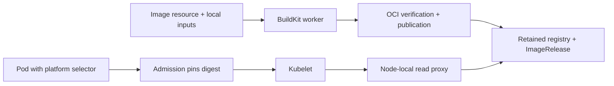

<a href="https://kimage.dev"></a>

# kimage

**Declare the images your Kubernetes cluster needs.**

[](https://github.com/inferal-oss/kimage/actions/workflows/ci.yml)
[](https://github.com/inferal-oss/kimage/actions/workflows/e2e.yml)
[](https://crates.io/crates/kimage-control)
[](https://www.rust-lang.org/)
[](LICENSE)

[Website](https://kimage.dev) · [Documentation](https://kimage.dev/docs/) · [Tutorial](#tutorial-build-and-run-a-hello-image)

kimage is a Kubernetes-native image catalog, builder, and delivery system. Define
an image, its version, and how to produce it as a Kubernetes `Image` resource. The controller handles build attempts, verifies the resulting
OCI content, publishes it to the installation's managed cluster-local registry,
and records an immutable `ImageRelease` in Kubernetes. Workloads can then select
that image directly:

```yaml
containers:
  - name: service
    image: "platform://apps/service:^1.2.0"
```

Admission resolves the selector to a published release and pins each new Pod to
its image digest. Kubelet pulls it through the node's local proxy using the normal
container runtime.

Use the same reference in **Deployments, StatefulSets, DaemonSets, ReplicaSets,
Jobs, CronJobs, and custom controllers** that pass image fields into Pods. Normal
containers, init containers, and native sidecars use the same resolution path.
Workload templates keep the selector; each generated Pod gets its own digest.
See [workload compatibility](https://kimage.dev/docs/#workload-compatibility)
for field locations, custom-controller requirements, and limits.

Application authors apply the desired `Image`; build execution and publication
are handled by the controller. They do not need to create a separate build-run
resource or choose an output registry URL and push credentials for each image.
Export to another registry is an explicit, optional step.

> **Status: alpha.** The current implementation has passed its four acceptance
> milestones on a specific Kubernetes profile. Native amd64 and arm64 installation
> and build checks run in CI for both installation scopes. Installation checks
> exact runtime versions. Read [compatibility and limits](#compatibility-and-limits)
> before trying it on a cluster.

From 0.6.1, the [compatibility foundation](docs/compatibility.md) separates
controller rollback from additive schema evolution. Prepared readers preserve
newer fields, pause unsupported builds individually and keep published images
usable. The 0.6.0 to 0.6.1 path keeps schema revision 6; later additive schemas
must declare and prove compatibility with the 0.6.1 reader baseline.

## Why kimage?

Image production usually involves a build definition, an execution trigger,
registry configuration, publication credentials, and a way to pass the resulting
reference to workloads. kimage provides one Kubernetes resource for the desired
image and manages the path from production to local consumption.

The installation includes a PVC-backed OCI registry and node-local read proxies.
The registry retains published releases independently of build inputs, build
attempts, and worker caches. "Local" means managed within the cluster, with
retained storage; node runtime caches are disposable.

This is useful when inputs already live in Kubernetes, when a cluster needs to
operate without an external registry, or when image availability and version
selection should be part of the application's declared state. Local builds and
pulls can operate disconnected once dependencies and inputs are provisioned.

A published Image UID/version/platform is immutable. The controller can retry failed
attempts, but different output for an existing version is a conflict. Request a
new version when changing the image's content.

## How it compares

These projects operate at different levels. The table summarizes their documented
core workflows; platform integrations can add registries, triggers, and deployment
automation. A separately configured registry can be local or remote.

| Approach | What you declare | What starts execution | Registry and publication | Workload consumption |
| --- | --- | --- | --- | --- |
| **kimage** | Desired `Image` and exact version; retained `ImageRelease` records the result | Controller reconciles the Image and manages attempts | Installation includes a retained cluster-local registry; external export is optional | `platform://` versions, ranges, or channels resolve to digest-pinned Pod images |
| **[Shipwright](https://shipwright.io/docs/build/)** | `Build` definition and a `BuildRun` referencing it or embedding its specification | Create or trigger a [BuildRun](https://shipwright.io/docs/build/buildrun/), executed through a build strategy | Configure `spec.output.image` and publication credentials for the selected registry | Consume the published registry reference through your deployment workflow |
| **[Tekton](https://tekton.dev/docs/pipelines/taskruns/)** | Tasks/Pipelines and their TaskRuns/PipelineRuns | A run executes the configured steps | Build/push tasks target a configured registry; see the [build-and-push example](https://tekton.dev/docs/how-to-guides/kaniko-build-push/) | Connect task results and registry references to your deployment workflow |
| **[kpack](https://github.com/buildpacks-community/kpack)** | An `Image` and Cloud Native Buildpacks builder configuration | Controller schedules builds on source, buildpack, or stack changes | Configure the image's registry tag and credentials; see the [tutorial](https://github.com/buildpacks-community/kpack/blob/main/docs/tutorial.md) | Image status exposes the resolved registry image for workloads to use |

### kimage and kpack

Both projects declare an `Image` and let a controller manage production. That
shared model, digest-pinned output, and [ARM64 support](https://github.com/buildpacks-community/kpack/blob/main/docs/stack.md#building-for-arm64) are useful capabilities,
not distinguishing features on their own.

| Area | kpack | kimage |
| --- | --- | --- |
| Build model | Cloud Native Buildpacks supply application language and runtime build logic | Containerfiles with provisioned inputs and frozen OCI base/toolchain images |
| Registry operation | Publish to a registry you configure and operate, which can be local | A retained cluster-local registry and node-local serving are included; external export is optional |
| Release model | Maintain an image as source, buildpacks, and stack change; expose its latest digest and build history | Publish immutable releases keyed by Image identity, version, and platform; select exact versions, ranges, or channels |
| Workload declaration | Deployment tooling consumes the resulting registry reference | Workloads request `platform://apps/service:^1.2.0`; admission resolves new Pods to the matching digest |
| Build demand | Rebuild on source, buildpack, and stack changes | Default to consumer demand; workload placement selects needed platforms, with administrator-configurable eager builds |

With kimage, the workload declares **which Image and which versions it accepts**.
It does not need to know the publication registry, repository path, or digest.
The included registry retains verified releases; admission resolves the request
and kubelet pulls through node-local serving using the normal runtime. The
registry is part of the installation, rather than a separate output service each
application author must choose. Administrators provision its storage; installation generates separate service
credentials.

For example, `platform://apps/service:^1.2.0` selects the highest compatible
published release below `2.0.0`. Each new Pod is pinned to that release's digest;
running Pods keep their existing digest. This is version selection from a retained
catalog, not automatic rollout of existing workloads.

kpack has the more established source-to-image workflow through Buildpacks. Its
[Image model](https://github.com/buildpacks-community/kpack/blob/main/docs/image.md)
and [tutorial](https://github.com/buildpacks-community/kpack/blob/main/docs/tutorial.md)
describe registry publication and digest output. kimage focuses on integrating
image production, immutable version contracts, registry operation, and workload
resolution. Shipwright offers configurable build strategies; Tekton orchestrates
general task pipelines. See [compatibility and limits](#compatibility-and-limits)
and the [website comparison](https://kimage.dev/docs/#comparison).

## Features

- **Frozen OCI inputs:** named exact base and toolchain releases enable offline multi-stage Containerfiles with native platform selection.

- **Native amd64 and arm64:** workload placement selects native builds; unconstrained
  mixed-cluster Pods use a fully verified OCI index.
- **Resumable upgrades:** explicit compatibility checks and rollback preserve registry data, credentials and the installation's CLI or Helm ownership.
- **Automatic node membership:** register native workers and UID-bound serving proxies as eligible nodes change, with administrator placement controls.
- **Build diagnostics:** follow per-platform output and inspect bounded private attempt logs after build Pod cleanup; use status and doctor for installation health.
- **On-demand or eager builds:** automatic Images wait for consumers by default;
  an administrator ConfigMap can prebuild available platforms.
- **Namespace or cluster scope:** manage one application namespace or all ordinary
  namespaces, with explicit exclusions and same-namespace image consumption.
- **Declare images:** an `Image` describes the version and how to produce it;
  the controller manages attempts, verification, and publication.
- **Managed local registry:** retained OCI storage and read proxies are included
  in the installation. Application images need no separate output registry setup.
- **Configurable production:** Containerfiles, local input mounts, builder selection,
  and cache policy are part of the Image specification. The initial adapter uses
  pinned BuildKit.
- **Immutable releases:** verified OCI content is published by digest and recorded
  in retained `ImageRelease` resources. Conflicting content cannot replace a version.
- **Readable version selection:** exact versions, semantic version ranges, and
  explicit channels work in workload image fields.
- **Normal image pulls:** node-local read proxies serve kubelet requests without a
  custom container runtime plugin.
- **Retained artifacts:** removing build inputs or clearing worker cache does not
  remove published releases.
- **Simple installation:** `kimage install` or Helm, with native amd64/arm64 component images published to GHCR on release. No binary uploads through the Kubernetes API.
- **Retained storage across maintenance:** Helm release history and the legacy guarded serving transitions preserve artifact identities within their documented compatibility windows.
- **Optional registry export:** a separate controller copies retained releases to
  an authenticated HTTPS registry.
- **Operational metrics:** build, publication, and pull latency, failures,
  transferred bytes, queueing, and catalog freshness.

## How it works



The `Image` is the desired state; build attempts are controller-managed execution
details, and an `ImageRelease` records a verified immutable result. The operator
manages production and publication. Admission reads the release catalog and records bounded missing-platform demand;
the operator builds and publishes images. The registry retains artifacts on a PVC, separately
from disposable builder cache. See the [architecture](docs/architecture.md) for
component boundaries and trust assumptions.

## Getting started

### Install the CLI

Install [Rust 1.99.0 or newer](https://www.rust-lang.org/tools/install), then:

```sh
cargo install kimage-control --version 0.6.1 --locked --bin kimage --bin kimage-install
kimage install --application-namespace apps
```

For an existing 0.6.0 installation, update the CLI, then use the guarded release
transition. Helm installations keep their Helm ownership and history:

```sh
kimage upgrade --to 0.6.1 --check
kimage upgrade --to 0.6.1
kimage doctor
```

0.6.1 keeps schema revision 6 and supports returning to 0.6.0 before unsupported features or newer schemas are used. Use `kimage rollback --to 0.6.0 --check` first, then repeat without `--check`. The earlier 0.5.2 to 0.6.0 boundary remains one way. See [compatibility](docs/compatibility.md) for future additive schemas and capability fencing.

An interrupted operation resumes with the same command. Running application
containers continue; builds, admission and new uncached pulls can pause while
components restart. See [upgrades and retained data](docs/installation.md#upgrades-rollback-and-removal).

No source checkout is needed. With no flags, `kimage install` manages the current
kubeconfig namespace. Components use public, digest-pinned amd64/arm64 images from
GHCR. The installer discovers native workers, generates credentials, provisions
the included registry, and waits for authenticated readiness. It sends only small
Kubernetes resources through the API. `kimage-install` is a compatible alias;
[prebuilt installers](https://github.com/inferal-oss/kimage/releases) are also available.
The crates.io package is **`kimage-control`**; `kimage` is an unrelated crate.

Use administrator kubeconfig, persistent storage and a supported Linux runtime
with Pod user namespaces. The default profile is the tested RKE2 profile. For the
tested K3s profile, add `--runtime-profile k3s`. This remains alpha software with
exact runtime checks; see [prerequisites](docs/installation.md#prerequisites).

### Build with a base or toolchain image

Declare exact, already published dependencies by name:

```yaml
imageInputs:
  - name: toolchain
    image: "platform://apps/go-toolchain:1.0.0"
  - name: runtime
    image: "platform://apps/runtime:1.0.0"
```

Use `FROM toolchain AS build`, then `FROM runtime` and `COPY --from=build` in
its Containerfile. kimage freezes the dependency UIDs and complete OCI roots,
selects native manifests and supplies verified local contexts to BuildKit.
The worker stays offline. See the [complete multi-stage example and limits](docs/image-inputs.md).

### Or install with Helm

```sh
helm repo add kimage https://kimage.dev/charts
helm repo update
kubectl create namespace apps
helm install kimage kimage/kimage --version 0.6.1 \
  --namespace kimage-system --create-namespace \
  --set applicationNamespace=apps --wait --wait-for-jobs
```

The release chart contains the same immutable image pins as the CLI. Its repository
is published with the website on GitHub Pages. Add `--set runtimeProfile=k3s` for
the tested K3s profile. The included registry stores application releases;
GHCR supplies kimage's system components.

### Or install with Argo CD

From 0.5.1, the same published chart supports Argo CD with `gitops.enabled: true`.
Starting with 0.5.1, changing the pinned chart version supports compatible upgrades
and downgrades with automatic interruption recovery. The returning older chart
uses the installed newer operator to check and perform its downgrade safely.

Use the [copyable Application](examples/argocd/cluster.yaml) and [Argo CD guide](docs/argocd.md).
The chart renders offline; an in-cluster provisioner discovers nodes, generates
credentials once and waits for readiness. Repeated syncs preserve credentials and
registry data. Argo CD deletion leaves the runtime and retained data in place;
the guide explains explicit removal, health and version boundaries.

Both methods support namespace or cluster scope. Use `kimage install --scope cluster`
or Helm `--set scope=cluster` to manage ordinary namespaces, with configurable
exclusions. See the [installation guide](docs/installation.md) for defaults,
mirrors, storage, reapplication, Helm values, removal and legacy compatibility,
and [platform selection and build policy](docs/platforms-and-scope.md).

The tutorial assumes namespace `apps` and the default builder are ready.

## Tutorial: build and run a hello image

The [example](examples/hello) copies a small static program into a scratch image,
publishes version `1.0.0`, and runs it through a readable range selector.

If you installed the commands with Cargo, download just the tutorial files:

```sh
mkdir -p examples/hello
for file in main.rs image.yaml deployment.yaml; do
  curl --fail --location --output "examples/hello/$file" \
    "https://kimage.dev/examples/hello/$file"
done
```

### 1. Compile the program

On a native Linux/amd64 or Linux/arm64 build machine with Rust and a musl linker installed (`musl-tools`
on Debian/Ubuntu):

```sh
case "$(uname -m)" in
  x86_64) ARCH=amd64; TARGET=x86_64-unknown-linux-musl ;;
  aarch64) ARCH=arm64; TARGET=aarch64-unknown-linux-musl ;;
  *) echo "Use a supported Linux build machine"; exit 1 ;;
esac
rustup target add "$TARGET"
mkdir -p .local/tutorial
rustc --edition=2024 --target "$TARGET" \
  -C opt-level=z -C strip=symbols -C panic=abort \
  examples/hello/main.rs -o ".local/tutorial/hello-$ARCH"
```

On macOS, compile this Linux executable on a matching native Linux machine or in a Linux
build container. A native macOS executable will not run in the scratch image.

For a mixed cluster, provide both `hello-amd64` and `hello-arm64` in
`.local/tutorial` before creating the ConfigMap, compiling on matching Linux
build machines. The automatic Image below uses `TARGETARCH` to select the file.
A single-platform cluster needs only its own executable.

### 2. Provide the build input

From a machine with `kubectl` configured for your development cluster:

```sh
kubectl -n apps create configmap hello-context \
  --from-file=.local/tutorial \
  --dry-run=client -o yaml | kubectl apply -f -
```

The small executable fits in a ConfigMap. Larger inputs can use a PVC; see
[input mounts and producer handoff](docs/operations.md#direct-containerfile-builds).

### 3. Declare the image

The [Image declaration](examples/hello/image.yaml) selects `Direct` execution on
the default builder, maps the ConfigMap into the build context, and supplies:

```dockerfile
FROM scratch
ARG TARGETARCH
COPY hello-${TARGETARCH} /hello
ENTRYPOINT ["/hello"]
```

Applying the Image declares that version. With the default OnDemand policy,
applying its Deployment starts the required native build. The controller handles
the build and publication to the managed registry; no separate build-run manifest
or output registry reference is needed:

```sh
kubectl apply -f examples/hello/image.yaml
```

The automatic Image stays `AwaitingDemand` until a consumer requests it.
For eager preparation, see [build policy](docs/platforms-and-scope.md#on-demand-and-eager-production).

The Image's `spec.version` is `1.0.0`. Its input mapping gives the executable
file mode `0555` (decimal `365` in YAML).

### 4. Run it

The [Deployment](examples/hello/deployment.yaml) selects
`platform://apps/hello:^1.0.0`:

```sh
kubectl apply -f examples/hello/deployment.yaml
kubectl -n apps wait --for=condition=Ready image/hello --timeout=10m
kubectl -n apps get imagereleases
kubectl -n apps rollout status deployment/hello --timeout=5m
kubectl -n apps logs deployment/hello
# Hello from kimage!

kubectl -n apps get pods -l app=hello \
  -o jsonpath='{.items[0].spec.containers[0].image}{"\n"}'
```

The final command shows the admitted Pod's registry reference pinned by
`@sha256:...`. The Deployment template keeps its symbolic selector.

For build progress or a failed attempt, use:

```sh
kimage builds hello --namespace apps
kimage logs hello --namespace apps --platform linux/arm64 --follow
```

Select the platform you need, or use `--attempt` with an ID from `builds`.
During worker recovery, builds wait for native worker and service readiness before capturing inputs.
The last five attempts per platform keep a private 64 KiB output tail after
build Pod cleanup. See [build diagnostics and failure handling](docs/operations.md#build-diagnostics-in-050)
for permissions, retries and retention limits.

### 5. Publish another version

Update the source input and change `spec.version` in `examples/hello/image.yaml`
before applying it again. A published version is immutable: changing its output
without changing its version produces `VersionConflict`.

Ranges are resolved when each Pod is created. Publishing a new matching release
does not restart an existing Deployment; a later replacement Pod may select it.
Use an exact version in the Deployment when every replica must use the same
release during a rollout.

## Image selectors

| Selector | Meaning |
| --- | --- |
| `platform://apps/service:1.2.4` | Exactly version `1.2.4` |
| `platform://apps/service:^1.2.0` | Highest published compatible version below `2.0.0` |
| `platform://apps/service:~1.2.0` | Highest published version in the `1.2` patch series |
| `platform://apps/service:stable` | The version explicitly mapped to channel `stable` |
| `platform://apps/service?version=^1.2.0` | Equivalent readable query form |

Quote selectors in YAML. Query ranges also accept percent encoding for
compatibility; it is unnecessary in manifest examples. Prereleases require an
explicitly matching prerelease requirement. Cross-namespace consumption and an
implicit `latest` are not supported. See the
[selector reference](docs/operations.md#archive-declarations-and-retained-releases)
for the full grammar and rollout behavior.

## Find and check installations

```sh
kimage installations
kimage status
kimage doctor
```

Commands use the current Kubernetes context. If the conventional installation is
missing, status and doctor discover and check every matching installation, even
when one check fails. Upgrade, rollback and uninstall discover too, but require an
explicit choice when several installations match. Use `--namespace SYSTEM` and
`--installation NAME` to select one, or `--no-discovery` to require the selected
identity without fallback. `install` still creates or resumes the identity you
request. See [installation discovery](docs/installation-discovery.md) for RBAC,
JSON output and Argo CD uninstall confirmation.

## Compatibility and limits

Native Kubernetes E2E covers Linux/amd64 and Linux/arm64. The earlier full acceptance fixture uses Linux/amd64, Kubernetes `v1.36.5+k3s1`,
containerd `2.3.4-k3s1.36`, and Ubuntu 24.04.5 with kernel `6.8.0-142`.
Mixed amd64/arm64 demand, build, and pull acceptance also passed on RKE2
`v1.36.5+rke2r1` with containerd `2.3.4-k3s1`, using the default `inferal`
runtime profile. The installer refuses untested exact runtime versions rather
than assuming compatibility.

The Containerfile adapter supports **scratch images, provisioned local inputs and frozen OCI base/toolchain inputs**.
Remote base images, remote build contexts, external frontends, and build network
access are outside its current scope. External exports support verified HTTPS
with Basic authentication or explicit anonymous access; Bearer/token-helper
authentication is not implemented.

Whole-installation upgrades support **0.6.0 ↔ 0.6.1** through the 0.6.1 guarded CLI,
including Helm installations, with compatibility preflight. Future additive schemas can remain installed when returning to a prepared reader. The earlier schema-6 boundary still refuses rollback to 0.5.2; earlier same-schema edges remain supported. Argo CD chart-version transitions start at 0.5.1
and require an explicitly supported compatibility edge. The earlier serving-only acceptance covered Distribution **3.1.1 ↔ 3.1.2** and
gateway/proxy **0.1.0 / 0.2.0 / 0.3.0** (cluster scope requires 0.3.0) with the documented filesystem storage profile.
High availability, arbitrary storage/schema migrations, hostile-tenant isolation,
signing/attestations, and automatic retained-artifact
garbage collection are future work.

## Development and CI

To build from source instead of installing from crates.io:

```sh
git clone https://github.com/inferal-oss/kimage.git
cd kimage
cargo build --locked --release --workspace --bins
```

The tutorial's relative paths assume these example files are in your current
directory. Run the source checks from the repository root:

```sh
cargo fmt --all --check
cargo clippy --locked --workspace --all-targets -- -D warnings
cargo test --locked --workspace
python3 -m compileall -q scripts
```

[GitHub Actions](https://github.com/inferal-oss/kimage/actions/workflows/ci.yml)
runs formatting, Clippy, documentation/example checks, and the workspace tests
on macOS/arm64 and native Linux/amd64 and Linux/arm64 musl. Python release, component/chart and lifecycle tests verify pinned inputs,
deterministic native packaging, immutable assets and interruption recovery. The Rust suite includes loopback HTTP, platform selection,
build policy and mocked Kubernetes API recovery regressions.

Native Kubernetes E2E runs CLI and Helm in both namespace and cluster scope on amd64 and
arm64, including actual native build execution and workload pulls, dry-run,
on-demand/eager policy, controller templates, RBAC and namespace boundaries.
The [0.4.0 acceptance record](docs/native-install-results.json) covers all eight cases.

The [published 0.6.1 verification](docs/published-0.6.1-results.json) checks
both crates, all release assets, public native GHCR indexes, Cargo installation,
automatic catalog fetching and the live Helm repository. The permanent cluster-wide
Argo installation upgrades from the public 0.6.0 chart to the public 0.6.1 chart
with built-in pins. Fresh placement cases pass before and after the upgrade.
Status/doctor are healthy; all 247 prior release contracts, nine credentials,
storage, policy and shared CRD identities stay intact. Complete readback verifies
71 OCI graphs, including the fresh before/after placement outputs.

The [0.6.1 native matrix](docs/native-0.6.1-results.json) passes all eight
CLI/Helm cases and four Argo CD cases through actual published 0.6.0 and back,
with interruption recovery and retained-data reinstall. An independently built
future writer populates schema 7, native build journals and provenance; unchanged
0.6.1 binaries retain that schema and opaque data, pause unsupported builds,
serve published roots and build unrelated Images. The [real mixed-cluster tests](docs/mixed-0.6.1-results.json)
repeat CLI, Helm and Argo CD transitions with fresh native amd64/arm64 workloads
in serial namespace fixtures. Shared schema 6 and all CRD identities stay intact.
The permanent cluster-wide installation retains 247 prior release contracts,
nine credentials, storage and policy, with complete readback of 62 OCI graphs.
Candidate acceptance precedes publication; synthetic schemas run only on disposable APIs.

The [published 0.6.0 verification](docs/published-0.6.0-results.json) checks
both crates, every release asset, anonymous native GHCR images, Cargo installation
and automatic catalog fetching. The public Helm chart runs through Argo CD on
the four-node mixed cluster with its built-in pins. Status/doctor are healthy;
retained storage, 203 previous release contracts, nine credentials and policy
remain intact, with complete readback of 18 prior and 35 new OCI graphs.

The [0.6.0 native matrix](docs/native-0.6.0-results.json) passes all eight
CLI/Helm cases and four Argo CD cases. The [real mixed-cluster record](docs/mixed-0.6.0-results.json)
upgrades a permanent cluster-wide installation from 0.5.2 and runs frozen OCI
base/toolchain builds on native amd64 and arm64. Fresh unknown placement builds
both; explicit placement builds only its requested platform. Later arm64 demand
keeps the original base UID and full OCI root after same-name base recreation.
Cache controls and refusal cases pass. All 203 prior release contracts, nine
service credentials, registry storage and administrator policy remain intact;
18 prior and 35 new release graphs verify completely. These candidate checks
precede final publication; historical receipts keep their original scope.

The [0.5.2 native acceptance record](docs/native-0.5.2-results.json) covers
published 0.5.1 → 0.5.2 → 0.5.1 in all eight CLI/Helm cases, plus four Argo CD
cases using a separate future-version conformance fixture. The
[published 0.5.2 receipt](docs/published-0.5.2-results.json) checks exact public
assets, Cargo installation and the live chart, then upgrades a permanent
cluster-wide Argo installation on four real mixed-architecture nodes. Fresh
unknown/amd64/arm64 placement cases pass before and after the upgrade; retained
identities and complete OCI image bytes remain intact. Default CLI discovery
finds the installation and doctor reports it healthy.

The [0.5.1 native acceptance record](docs/native-0.5.1-results.json) covers
published 0.5.0 → 0.5.1 → 0.5.0 with CLI and Helm in all eight cases,
plus four actual Argo CD cases. Argo changes chart versions from 0.5.1 to a
separate future-version conformance fixture and back, including interrupted
provisioner and downgrade-helper recovery. The fixture is not a public release.
The [0.5.1 real mixed-cluster record](docs/mixed-0.5.1-results.json) covers
CLI/Helm 0.5.0 → 0.5.1 → 0.5.0 and both Argo CD installation scopes,
including interrupted chart upgrades/downgrades, fresh native placement cases,
node changes and complete retained-image readback after removal/reinstall.
It preserves earlier unsuccessful attempts and the subsequent complete repeat.
The [published 0.5.1 receipt](docs/published-0.5.1-results.json) independently
verifies Cargo installation, automatic catalog fetching, public assets and the
live Helm repository. Its real Argo CD test uses the public chart's built-in
pins and confirms native builds and retained data after removal/reinstall.
The [0.5.0 native lifecycle record](docs/native-upgrade-results.json) adds actual
published 0.4.1 → 0.5.0 → 0.4.1 transitions in all eight cases, with interrupted
upgrade/rollback, private failed-build logs and complete retained-image readback.
The same round trip passed with CLI and Helm on our
[real mixed cluster](docs/mixed-upgrade-results.json), including native GHCR pulls,
fresh unknown/explicit placement builds, node eligibility and worker pin changes,
and retained registry/PVC and ImageRelease identities after uninstall/reinstall.
Node changes use reversible fixture labels; shared Nodes are never deleted or cordoned.
This matrix gates releases. The separate [opt-in mixed-cluster E2E](docs/mixed-cluster-e2e.md)
passed twice on real amd64 and arm64 RKE2 nodes with the published 0.3.0 binaries.
Fresh Images confirm unknown placement builds both variants and explicit placement
builds only the requested platform; native consumers pull the selected index or
manifest. See the [recorded results](docs/mixed-cluster-results.json). Public CI
validates this harness; the live mixed test is explicitly enabled against an
approved cluster. The published 0.4.0 CLI and public Helm chart also passed
[real mixed-cluster checks](docs/mixed-install-results.json), including native
GHCR component pulls and full retained image graph readback after
uninstall/reinstall. The receipt records an intermittent CLI uninstall race,
its successful retry and the fix shipped in 0.4.1. Earlier two-node interruption/recovery, binary rollback and
external-export harnesses remain separately recorded acceptance evidence.

Contributions are welcome through [issues](https://github.com/inferal-oss/kimage/issues)
and pull requests. Include the relevant validation and update the docs when
changing supported behavior.

## Documentation

- [Installation with CLI or Helm](docs/installation.md) and [Argo CD](docs/argocd.md)
- [Legacy operations and build reference](docs/operations.md)
- [Architecture](docs/architecture.md)
- [Build contracts and execution](docs/build-design.md)
- [Binary upgrade and rollback](docs/binary-upgrade-design.md)
- [Registry export](docs/export-design.md)
- [Acceptance ledger](docs/status.md) and [requirements audit](docs/requirements-audit.md)
- [Original implementation brief](docs/implementation-prompt.md)
- [Website source and deployment](site/README.md)
- [Release procedure](docs/releasing.md) and [changelog](CHANGELOG.md)

## License

[Apache License 2.0](LICENSE).
