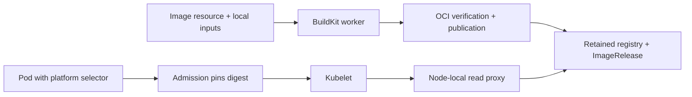

# kimage

**Declare the images your Kubernetes cluster needs.**

[](https://github.com/inferal-oss/kimage/actions/workflows/ci.yml)
[](https://www.rust-lang.org/)
[](LICENSE)

[Website](https://kimage.dev) · [Documentation](docs/operations.md) · [Tutorial](#tutorial-build-and-run-a-hello-image)

kimage lets you define an image, its version, and how to produce it as a Kubernetes
`Image` resource. The controller handles build attempts, verifies the resulting
OCI content, publishes it to the installation's managed cluster-local registry,
and records an immutable `ImageRelease` in Kubernetes. Workloads can then select
that image directly:

```yaml
containers:
  - name: service
    image: "platform://apps/service:^1.2.0"
```

Admission resolves the selector to a published release and pins each new Pod to
its image digest. Kubelet pulls it through the node's local proxy using the normal
container runtime.

Application authors apply the desired `Image`; build execution and publication
are handled by the controller. They do not need to create a separate build-run
resource or choose an output registry URL and push credentials for each image.
Export to another registry is an explicit, optional step.

> **Status: alpha.** The current implementation has passed its four acceptance
> milestones on a specific Linux/amd64 Kubernetes profile. Installation checks
> exact runtime versions. Read [compatibility and limits](#compatibility-and-limits)
> before trying it on a cluster.

## Why kimage?

Image production usually involves a build definition, an execution trigger,
registry configuration, publication credentials, and a way to pass the resulting
reference to workloads. kimage provides one Kubernetes resource for the desired
image and manages the path from production to local consumption.

The installation includes a PVC-backed OCI registry and node-local read proxies.
The registry retains published releases independently of build inputs, build
attempts, and worker caches. "Local" means managed within the cluster, with
retained storage; node runtime caches are disposable.

This is useful when inputs already live in Kubernetes, when a cluster needs to
operate without an external registry, or when image availability and version
selection should be part of the application's declared state. Local builds and
pulls can operate disconnected once dependencies and inputs are provisioned.

A published Image UID/version is immutable. The controller can retry failed
attempts, but different output for an existing version is a conflict. Request a
new version when changing the image's content.

## How it compares

These projects operate at different levels. The table summarizes their documented
core workflows; platform integrations can add registries, triggers, and deployment
automation. A separately configured registry can be local or remote.

| Approach | What you declare | What starts execution | Registry and publication | Workload consumption |
| --- | --- | --- | --- | --- |
| **kimage** | Desired `Image` and exact version; retained `ImageRelease` records the result | Controller reconciles the Image and manages attempts | Installation includes a retained cluster-local registry; external export is optional | `platform://` versions, ranges, or channels resolve to digest-pinned Pod images |
| **[Shipwright](https://shipwright.io/docs/build/)** | `Build` definition and a `BuildRun` referencing it or embedding its specification | Create or trigger a [BuildRun](https://shipwright.io/docs/build/buildrun/), executed through a build strategy | Configure `spec.output.image` and publication credentials for the selected registry | Consume the published registry reference through your deployment workflow |
| **[Tekton](https://tekton.dev/docs/pipelines/taskruns/)** | Tasks/Pipelines and their TaskRuns/PipelineRuns | A run executes the configured steps | Build/push tasks target a configured registry; see the [build-and-push example](https://tekton.dev/docs/how-to-guides/kaniko-build-push/) | Connect task results and registry references to your deployment workflow |
| **[kpack](https://github.com/buildpacks-community/kpack)** | An `Image` and Cloud Native Buildpacks builder configuration | Controller schedules builds on source, buildpack, or stack changes | Configure the image's registry tag and credentials; see the [tutorial](https://github.com/buildpacks-community/kpack/blob/main/docs/tutorial.md) | Image status exposes the resolved registry image for workloads to use |

kpack also provides declarative images. kimage's particular focus is the combination
of **immutable versioned releases, a managed local registry, and integrated
workload resolution**. Shipwright offers configurable build strategies; Tekton
orchestrates general task pipelines; kpack provides Cloud Native Buildpacks
automation. kimage's current build adapter is narrower: Containerfiles with
scratch images and provisioned local inputs. See [compatibility and limits](#compatibility-and-limits).

## Features

- **Declare images:** an `Image` describes the version and how to produce it;
  the controller manages attempts, verification, and publication.
- **Managed local registry:** retained OCI storage and read proxies are included
  in the installation. Application images need no separate output registry setup.
- **Configurable production:** Containerfiles, local input mounts, builder selection,
  and cache policy are part of the Image specification. The initial adapter uses
  pinned BuildKit.
- **Immutable releases:** verified OCI content is published by digest and recorded
  in retained `ImageRelease` resources. Conflicting content cannot replace a version.
- **Readable version selection:** exact versions, semantic version ranges, and
  explicit channels work in workload image fields.
- **Normal image pulls:** node-local read proxies serve kubelet requests without a
  custom container runtime plugin.
- **Retained artifacts:** removing build inputs or clearing worker cache does not
  remove published releases.
- **API-only installation and recovery:** native macOS/arm64 and Linux/amd64
  installers bootstrap, verify, and recover the system through Kubernetes APIs.
- **Guarded upgrades and rollback:** compatible serving binaries can be replaced
  and rolled back while preserving storage and release identities.
- **Optional registry export:** a separate controller copies retained releases to
  an authenticated HTTPS registry.
- **Operational metrics:** build, publication, and pull latency, failures,
  transferred bytes, queueing, and catalog freshness.

## How it works



The `Image` is the desired state; build attempts are controller-managed execution
details, and an `ImageRelease` records a verified immutable result. The operator
manages production and publication. Admission reads the release catalog; it does
not build or publish images. The registry retains artifacts on a PVC, separately
from disposable builder cache. See the [architecture](docs/architecture.md) for
component boundaries and trust assumptions.

## Getting started

### Build the tools

Install [Rust 1.99.0](https://www.rust-lang.org/tools/install), then:

```sh
git clone https://github.com/inferal-oss/kimage.git
cd kimage
cargo build --locked --release --workspace --bins
./target/release/kimage-install --help
```

This builds binaries for your machine. Cluster components need static
Linux/amd64 builds; building the native installer on a Mac does not build those
components for Linux.

### Prepare a cluster

Follow the [installation and operations guide](docs/operations.md) to package a
trusted offline bundle, supply TLS credentials, and run the installer phases:
`bootstrap`, `seed`, `handover`, `control-plane`, and `builder`.

You need a supported Linux/amd64 cluster, administrator access, persistent
storage, an approved carrier image already cached on the selected node, and
kernel/runtime support for the builder's Kubernetes user namespace. The default
builder uses BuildKit 0.33.0. Setup is currently an explicit administrator workflow;
there are no prebuilt GitHub release bundles or Helm chart yet.

The tutorial below assumes an application namespace named `apps` has been
configured by the installer and `builderRef: default` is ready. Use a disposable
development cluster for your first installation.

## Tutorial: build and run a hello image

The [example](examples/hello) copies a small static program into a scratch image,
publishes version `1.0.0`, and runs it through a readable range selector.

### 1. Compile the program

On a Linux/amd64 build machine with Rust and a musl linker installed (`musl-tools`
on Debian/Ubuntu):

```sh
rustup target add x86_64-unknown-linux-musl
mkdir -p .local/tutorial
rustc --edition=2024 --target x86_64-unknown-linux-musl \
  -C opt-level=z -C strip=symbols -C panic=abort \
  examples/hello/main.rs -o .local/tutorial/hello
```

On macOS, compile this Linux executable on a Linux/amd64 machine or in a Linux
build container. A native macOS executable will not run in the scratch image.

### 2. Provide the build input

From a machine with `kubectl` configured for your development cluster:

```sh
kubectl -n apps create configmap hello-context \
  --from-file=hello=.local/tutorial/hello \
  --dry-run=client -o yaml | kubectl apply -f -
```

The small executable fits in a ConfigMap. Larger inputs can use a PVC; see
[input mounts and producer handoff](docs/operations.md#direct-containerfile-builds).

### 3. Declare the image

The [Image declaration](examples/hello/image.yaml) selects `Direct` execution on
the default builder, maps the ConfigMap into the build context, and supplies:

```dockerfile
FROM scratch
COPY hello /hello
ENTRYPOINT ["/hello"]
```

Applying the Image requests that version's availability. The controller handles
the build and publication to the managed registry; no separate build-run manifest
or output registry reference is needed:

```sh
kubectl apply -f examples/hello/image.yaml
kubectl -n apps wait --for=condition=Ready image/hello --timeout=10m
kubectl -n apps get imagereleases
```

The Image's `spec.version` is `1.0.0`. Its input mapping gives the executable
file mode `0555` (decimal `365` in YAML).

### 4. Run it

The [Deployment](examples/hello/deployment.yaml) selects
`platform://apps/hello:^1.0.0`:

```sh
kubectl apply -f examples/hello/deployment.yaml
kubectl -n apps rollout status deployment/hello --timeout=5m
kubectl -n apps logs deployment/hello
# Hello from kimage!

kubectl -n apps get pods -l app=hello \
  -o jsonpath='{.items[0].spec.containers[0].image}{"\n"}'
```

The final command shows the admitted Pod's registry reference pinned by
`@sha256:...`. The Deployment template keeps its symbolic selector.

### 5. Publish another version

Update the source input and change `spec.version` in `examples/hello/image.yaml`
before applying it again. A published version is immutable: changing its output
without changing its version produces `VersionConflict`.

Ranges are resolved when each Pod is created. Publishing a new matching release
does not restart an existing Deployment; a later replacement Pod may select it.
Use an exact version in the Deployment when every replica must use the same
release during a rollout.

## Image selectors

| Selector | Meaning |
| --- | --- |
| `platform://apps/service:1.2.4` | Exactly version `1.2.4` |
| `platform://apps/service:^1.2.0` | Highest published compatible version below `2.0.0` |
| `platform://apps/service:~1.2.0` | Highest published version in the `1.2` patch series |
| `platform://apps/service:stable` | The version explicitly mapped to channel `stable` |
| `platform://apps/service?version=^1.2.0` | Equivalent readable query form |

Quote selectors in YAML. Query ranges also accept percent encoding for
compatibility; it is unnecessary in manifest examples. Prereleases require an
explicitly matching prerelease requirement. Cross-namespace consumption and an
implicit `latest` are not supported. See the
[selector reference](docs/operations.md#archive-declarations-and-retained-releases)
for the full grammar and rollout behavior.

## Compatibility and limits

The full acceptance fixture uses Linux/amd64, Kubernetes `v1.36.5+k3s1`,
containerd `2.3.4-k3s1.36`, and Ubuntu 24.04.5 with kernel `6.8.0-142`.
An earlier RKE2 foundation profile is documented separately. The installer
refuses untested runtime versions rather than assuming compatibility.

The first build adapter supports **scratch images and provisioned local inputs**.
Remote base images, remote build contexts, external frontends, and build network
access are outside its current scope. External exports support verified HTTPS
with Basic authentication or explicit anonymous access; Bearer/token-helper
authentication is not implemented.

The tested serving upgrade window is Distribution **3.1.1 ↔ 3.1.2** and
gateway/proxy **0.1.0 ↔ 0.2.0** with the documented filesystem storage profile.
High availability, arbitrary storage/schema migrations, hostile-tenant isolation,
multi-platform images, signing/attestations, and automatic retained-artifact
garbage collection are future work.

## Development and CI

```sh
cargo fmt --all --check
cargo clippy --locked --workspace --all-targets -- -D warnings
cargo test --locked --workspace
python3 -m compileall -q scripts
```

[GitHub Actions](https://github.com/inferal-oss/kimage/actions/workflows/ci.yml)
runs formatting, Clippy, documentation/example checks, and the workspace tests
on macOS/arm64 and Linux/amd64 musl. The current suite has 49 tests, including
loopback HTTP and mocked Kubernetes API recovery regressions. Live cluster
acceptance exercises installation, builds, two-node pulls, interruption/recovery,
binary upgrades/rollback, and external export; those fixture tests are recorded
separately and are not run by ordinary CI.

Contributions are welcome through [issues](https://github.com/inferal-oss/kimage/issues)
and pull requests. Include the relevant validation and update the docs when
changing supported behavior.

## Documentation

- [Installation and operations](docs/operations.md)
- [Architecture](docs/architecture.md)
- [Build contracts and execution](docs/build-design.md)
- [Binary upgrade and rollback](docs/binary-upgrade-design.md)
- [Registry export](docs/export-design.md)
- [Acceptance ledger](docs/status.md) and [requirements audit](docs/requirements-audit.md)
- [Original implementation brief](docs/implementation-prompt.md)
- [Website source and deployment](site/README.md)

## License

[Apache License 2.0](LICENSE).
